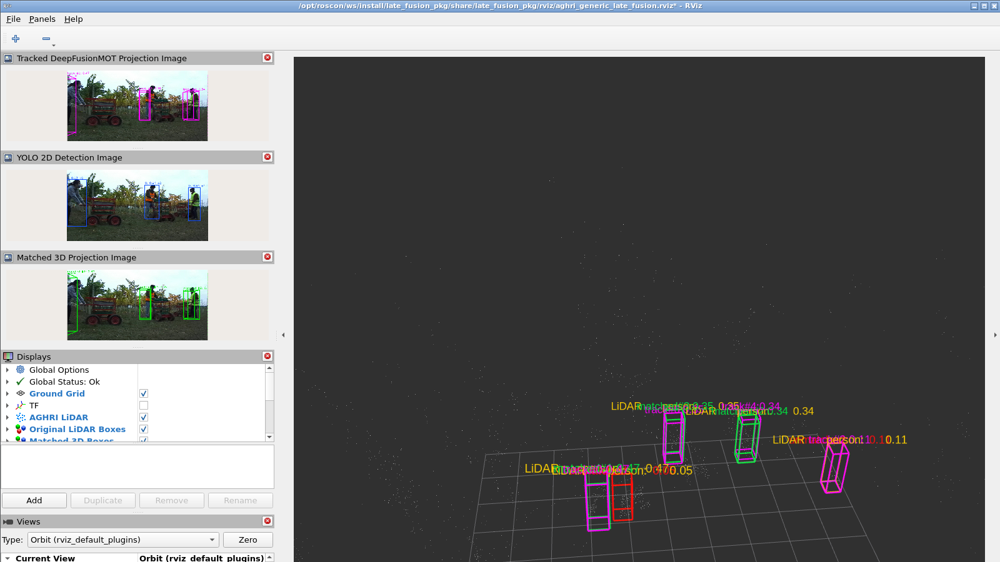
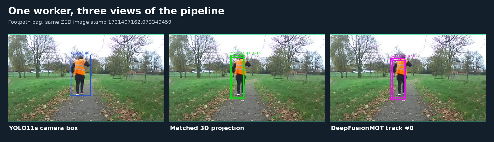
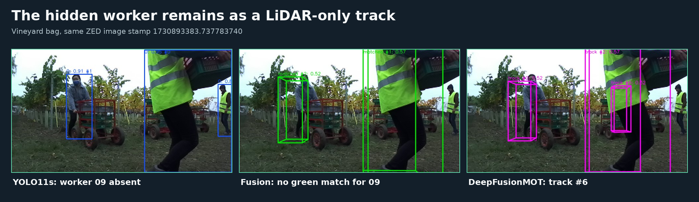
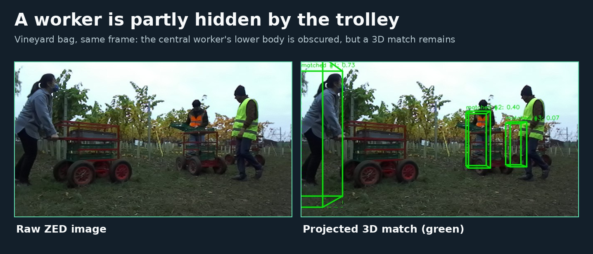

# ROSCon 2026: camera–LiDAR detection and tracking

Replay an AGHRI ROS 2 recording, inspect camera and LiDAR detections, and see how late fusion and DeepFusionMOT track people in RViz2. The workshop runs in a VS Code Dev Container on **Ubuntu**.

| Mode | Detection stage | Fusion, tracking, and RViz2 |
| --- | --- | --- |
| **CPU cached detections** | Replays prerecorded YOLO11s and PointPillars predictions | Runs live |
| **GPU live detections** | Runs YOLO11s and PointPillars on an NVIDIA GPU | Runs live |

Both modes use the same `vine` and `footpath` bags. The bags, CPU caches, and GPU checkpoints are supplied in a separate download.

**Before the workshop:** Complete Steps 1–3: install the prerequisites, clone the repository, download and verify the workshop data, and open your chosen Dev Container once so Docker can build its image. Build both modes in advance if you want to try both; the first build can take time.

**During the workshop:** Start at Step 4 to play a bag and explore the activities.

## Prerequisites

### 1. Install Docker

Install [Docker Engine with the Compose plugin](https://docs.docker.com/engine/install/ubuntu/), [VS Code](https://code.visualstudio.com/docs/setup/linux), the **Dev Containers** extension, and Git. Configure Docker so your user can run it from VS Code; follow [Docker's Linux post-installation steps](https://docs.docker.com/engine/install/linux-postinstall/) if needed.

In an Ubuntu terminal, check:

```bash
docker version
docker compose version
docker info >/dev/null
```

For **GPU mode**, also install an NVIDIA driver and the [NVIDIA Container Toolkit](https://docs.nvidia.com/datacenter/cloud-native/container-toolkit/latest/install-guide.html), then check `nvidia-smi` on the host. CPU mode needs no GPU.

### 2. Download the repository and data

Clone the GitHub repository:

```bash
mkdir -p ~/roscon-workshop
cd ~/roscon-workshop
git clone https://github.com/Prabuddhi-05/late_fusion_roscon.git
```

Download the data from the [shared workshop folder](https://universityoflincoln-my.sharepoint.com/:f:/g/personal/26619055_students_lincoln_ac_uk/IgAVkIggjvc_TpyG5g9QUilrAQfLTD1STLp0pPAM_adhxU0?e=45KeAd). Extract it beside the clone in a folder named **`late_fusion_roscon_data`**. The folder should contain:

```text
~/roscon-workshop/
├── late_fusion_roscon/
└── late_fusion_roscon_data/
    ├── bags/
    │   ├── footpath/
    │   └── vine/
    ├── caches/
    │   ├── footpath/
    │   └── vine/
    └── checkpoints/
```

Check that the download is complete:

```bash
cd ~/roscon-workshop/late_fusion_roscon_data
sha256sum -c SHA256SUMS.txt
```

The CPU container mounts `bags` and `caches`; the GPU container mounts `bags` and `checkpoints`. You do not need to copy these files into the GitHub repository.

### 3. Build and open a Dev Container

1. Open `~/roscon-workshop/late_fusion_roscon` in VS Code (**File → Open Folder**).
2. Press **Ctrl+Shift+P**, select **Dev Containers: Reopen in Container**, and choose either **ROSCon CPU cached detections** or **ROSCon GPU live detections**.
3. Wait for the image build and for VS Code to reopen with the selected container name in its title bar. The first build downloads dependencies and can take time.
4. Open **Terminal → New Terminal**. The prompt should be inside `/workspace`.

VS Code starts the selected service from `compose.yaml`. If you later want the other mode, reopen the folder locally and repeat these steps with the other configuration.

## Hands-on workshop

### 4. Play a bag and open RViz2

In the **container terminal**, run one recording:

```bash
bash run.sh footpath
```

Open VS Code's **PORTS** tab, find **ROSCon RViz2 desktop** (container port **6080**), and choose **Open in Browser**. Open the forwarded address with `/vnc.html` at the end, then click **Connect**. For example, if VS Code forwards to port 6080, use `http://localhost:6080/vnc.html`. Use the actual forwarded address shown in **PORTS** if it differs.

When the bag finishes, the terminal should print `cpu footpath pipeline: PASS` or `gpu footpath pipeline: PASS`. To play the other scene, run:

```bash
bash run.sh vine
```

### 5. Understand the RViz2 view

This is an actual vineyard replay. The image panels are on the left; the point cloud and 3D boxes are on the right.



| Color | RViz2 display | Meaning |
| --- | --- | --- |
| **Blue** | YOLO 2D Detection Image | Camera detector's 2D person box. |
| **Yellow** | Original LiDAR Boxes | PointPillars' original 3D person proposal. |
| **Green** | Matched 3D Boxes / Matched 3D Projection Image | A LiDAR proposal accepted as a match to a camera detection. |
| **Red** | Unmatched LiDAR Boxes | A LiDAR proposal with no accepted camera match in that fusion update. |
| **Magenta** | Tracked DeepFusionMOT Boxes / Tracked DeepFusionMOT Projection Image | A track maintained by DeepFusionMOT; its number is a tracker ID. |

The colored 3D boxes can overlap because each display shows a different stage of the same pipeline. **Red does not by itself mean a false detection**: the person may be occluded, outside the camera view, missed by YOLO11s, or incorrectly matched. Inspect the image, point cloud, and nearby frames before deciding.

### 6. Try the activities

#### Activity 1: Follow a person in two scenes

Play each bag at half speed, one after the other:

```bash
ROSCON_PLAYBACK_RATE=0.5 bash run.sh footpath
ROSCON_PLAYBACK_RATE=0.5 bash run.sh vine
```

Follow a magenta track number through successive frames. **Question:** does it stay the same when the person moves away, crosses another worker, or is briefly hidden? The footpath has fewer people; the vineyard has several workers and trolleys.

#### Activity 2: Reveal each processing stage

Run either bag. In RViz2's **Displays** panel, toggle these checkboxes one at a time:

1. **YOLO 2D Detection Image** — camera detections.
2. **AGHRI LiDAR** and **Original LiDAR Boxes** — point cloud and raw LiDAR proposals.
3. **Matched 3D Boxes** and **Matched 3D Projection Image** — camera–LiDAR matches.
4. **Unmatched LiDAR Boxes** — proposals without a camera match.
5. **Tracked DeepFusionMOT Boxes** and **Tracked DeepFusionMOT Projection Image** — tracker output.

**Question:** which boxes remain when a camera match is absent? The checkboxes only change what RViz2 displays; the pipeline keeps running.

#### Activity 3: Change the matching threshold

First play `footpath` at half speed with the default IoU threshold, `0.10`:

```bash
ROSCON_PLAYBACK_RATE=0.5 bash run.sh footpath
```

For a second run, start the same command in **terminal A**. During the launch delay, before bag playback begins, use **terminal B** in the same container:

```bash
source /opt/ros/humble/setup.bash
ros2 param get /aghri_late_fusion iou_threshold
ros2 param set /aghri_late_fusion iou_threshold 0.5
```

If the node has not appeared, retry the `get` command, then set the value. Compare the green matched boxes, red unmatched boxes, and magenta tracks. A fresh launch restores `0.10`.

In a tested **CPU footpath** replay, the number of accepted matches across the recording changed from **175 to 75**; tracks continued. These are summed matches across frames, not unique people. GPU results can differ.

### 7. Explore example scenes

#### Footpath: a straightforward match

Near **3.9 seconds into the bag**, compare the blue camera box, green projected LiDAR match, and magenta track around the worker.



#### Vineyard: a worker fully hidden in the camera image

Near **2.8 seconds into the bag**, a foreground worker crosses in front of another. The hidden worker has no separate YOLO11s box in this image, but a LiDAR proposal remains near that worker and DeepFusionMOT keeps a 3D track. The screenshot shows the same camera frame at three pipeline stages.



The AGHRI annotation calls the hidden worker **09**; DeepFusionMOT calls the nearby track **#6**. Those IDs come from different systems. LiDAR does not see through a person; the sensors have different viewpoints and timing.

#### Vineyard: partial trolley occlusion

Near **9.6 seconds into the bag**, a trolley hides part of a worker, but a green 3D match remains. Compare this with the fully hidden worker above.



An unmatched LiDAR box elsewhere in the scene is only a proposal. Check surrounding frames before treating it as a hidden person.

## Troubleshooting

| Problem | Check |
| --- | --- |
| Bag, cache, or checkpoint missing | Confirm `late_fusion_roscon_data` is beside the repo and the folder names match Step 2. If data was added after opening the container, run **Dev Containers: Rebuild Container**. |
| Browser shows a directory listing | Add **`/vnc.html`** to the forwarded address. |
| Port 6080 is occupied | Add `ROSCON_DESKTOP_PORT=6081` to `.env`, reopen the container, and use the new address in **PORTS**. |
| Docker permission error | Make sure `docker info` works as your Ubuntu user before opening VS Code. |
| GPU mode says CUDA is unavailable | Check the host driver and NVIDIA Container Toolkit, or use the CPU cached detections container. |

## Background

For the dataset video, sensor examples, late-fusion figures, and the four DeepFusionMOT association levels, see [AGHRI and DeepFusionMOT: workshop background](docs/BACKGROUND.md).
