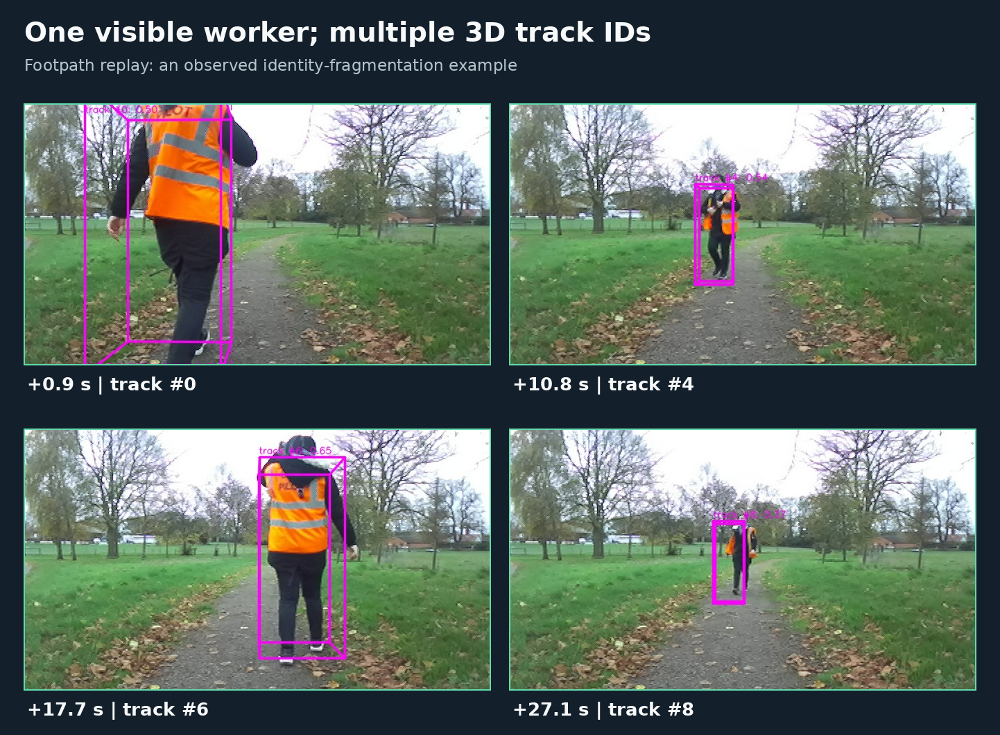

# ROSCon UK 2026 workshop: ROS in the Field

## ROS 2 late camera–LiDAR fusion and human tracking on AGHRI

Replay an AGHRI dataset ROS 2 recording to inspect camera and LiDAR detections, see how the DeepFusionMOT pipeline fuses them and tracks humans, and view the results in RViz2. The workshop runs in a VS Code Dev Container on **Ubuntu x86-64**.

| Mode | Detection stage | Fusion, tracking, and RViz2 |
| --- | --- | --- |
| **CPU cached detections** | Replays prerecorded YOLO11s and PointPillars predictions | Runs live |
| **GPU live detections** | Runs YOLO11s and PointPillars on an NVIDIA GPU | Runs live |

Both modes use the same `vine` and `footpath` bags. The bags, CPU caches, and GPU checkpoints are supplied in a [separate download](https://universityoflincoln-my.sharepoint.com/:f:/g/personal/26619055_students_lincoln_ac_uk/IgAVkIggjvc_TpyG5g9QUilrAQfLTD1STLp0pPAM_adhxU0?e=45KeAd).

**Before the workshop:** Complete Steps 1–3. Install the prerequisites, download and verify the data, then open your chosen Dev Container and wait for VS Code to reopen inside it. This completes that mode's initial Docker image build. If you plan to try both modes, repeat Step 3 for the other mode before the workshop.

**During the workshop:** Start at Step 4 to play a bag and explore the activities.

## Prerequisites

### 1. Install Docker

Install [Docker Engine with the Compose plugin](https://docs.docker.com/engine/install/ubuntu/), [VS Code](https://code.visualstudio.com/docs/setup/linux), the **Dev Containers** extension, and Git. Configure your Ubuntu user account to run Docker without `sudo`, so VS Code Dev Containers can start the container. If `docker info` reports a permission error, follow [Docker's Linux post-installation steps](https://docs.docker.com/engine/install/linux-postinstall/).

In an Ubuntu terminal, check:

```bash
docker version
docker compose version
docker info >/dev/null
```

For **GPU mode**, use an NVIDIA GPU, install an NVIDIA driver and the [NVIDIA Container Toolkit](https://docs.nvidia.com/datacenter/cloud-native/container-toolkit/latest/install-guide.html), then check `nvidia-smi` on the host and `docker run --rm --gpus all ubuntu:22.04 nvidia-smi` in an Ubuntu terminal. CPU mode needs no GPU.

### 2. Download the repository and data

Clone the GitHub repository:

```bash
mkdir -p ~/roscon-workshop
cd ~/roscon-workshop
git clone https://github.com/Prabuddhi-05/late_fusion_roscon.git
```

Download the data from the [shared workshop folder](https://universityoflincoln-my.sharepoint.com/:f:/g/personal/26619055_students_lincoln_ac_uk/IgAVkIggjvc_TpyG5g9QUilrAQfLTD1STLp0pPAM_adhxU0?e=45KeAd). Extract it beside the clone in a folder named **`late_fusion_roscon_data`**. The folder should contain:

```text
~/roscon-workshop/
├── late_fusion_roscon/
└── late_fusion_roscon_data/
    ├── bags/
    │   ├── footpath/
    │   └── vine/
    ├── caches/
    │   ├── footpath/
    │   └── vine/
    └── checkpoints/
```

Check that the download is complete:

```bash
cd ~/roscon-workshop/late_fusion_roscon_data
sha256sum -c SHA256SUMS.txt
```

The CPU container mounts `bags` and `caches`; the GPU container mounts `bags` and `checkpoints`. Do not copy these files into the `late_fusion_roscon` repository.

### 3. Build and open a Dev Container

1. Open `~/roscon-workshop/late_fusion_roscon` in VS Code (**File → Open Folder**).
2. Press **Ctrl+Shift+P**, select **Dev Containers: Reopen in Container**, and choose either **ROSCon CPU cached detections** or **ROSCon GPU live detections**.
3. The first time you open a mode, Docker builds its image and downloads dependencies. Wait until VS Code reopens with the selected container name in its title bar; this can take time.
4. Open **Terminal → New Terminal**. The prompt should be inside `/workspace`, with ROS 2 ready to use.

VS Code starts the selected service from `compose.yaml`. If you later want the other mode, reopen the folder locally and repeat these steps with the other configuration.

## Hands-on workshop

### 4. Play a ROS 2 bag and open RViz2

The **footpath** bag shows one person and is a good place to start. In the **container terminal**, run:

```bash
bash run.sh footpath
```

`run.sh` selects the bag, checks the required files, launches the ROS 2 pipeline, and checks its output. You can use `ros2` commands directly in any new container terminal.

Open VS Code's **PORTS** tab, find **ROSCon RViz2 desktop** (container port **6080**), and choose **Open in Browser**. Open the forwarded address with `/vnc.html` at the end, then click **Connect**. The usual addresses are `http://localhost:6080/vnc.html` for CPU mode and `http://localhost:6081/vnc.html` for GPU mode; use the actual address shown in **PORTS** if it differs.

When the bag finishes, the terminal should print `cpu footpath pipeline: PASS` or `gpu footpath pipeline: PASS`. The **vineyard** bag shows four workers, trolleys, and trays. To play it, run:

```bash
bash run.sh vine
```

To see the ROS 2 topics while a bag is playing, open a second container terminal and run:

```bash
ros2 topic list -t
```

The main topic families are the same in both modes:

| Topic family and example topics | What they carry |
| --- | --- |
| **/dataset/**<br>`/dataset/cam_zed_rgb/image`<br>`/dataset/lidar/points` | Camera images and LiDAR points replayed from the bag. |
| **/detector/**<br>`/detector/camera/detections`<br>`/detector/lidar/detections` | YOLO11s and PointPillars predictions: replayed caches in CPU mode, live inference in GPU mode. |
| **/late_fusion/**<br>`/late_fusion/matched_3d`<br>`/late_fusion/unmatched_lidar`<br>`/late_fusion/unmatched_camera` | Matched 3D detections, unmatched LiDAR 3D detections, and unmatched camera 2D detections. |
| **/deepfusionmot/**<br>`/deepfusionmot/tracked_3d`<br>`/deepfusionmot/tracked_2d` | Live 3D and 2D tracks. |
| **/visualization/**<br>`/visualization/tracked_projection_image`<br>`/visualization/tracked_3d_markers` | Images and markers shown in RViz2. |

### 5. Understand the RViz2 view

This is an actual vineyard replay. The image panels are on the left; the point cloud and 3D boxes are on the right.


| Color | RViz2 display | Meaning |
| --- | --- | --- |
| **Blue** | YOLO 2D Detection Image | YOLO11s' 2D human detections. |
| **Yellow** | Original LiDAR Boxes | PointPillars' original 3D human detections. |
| **Green** | Matched 3D Boxes / Matched 3D Projection Image | PointPillars' 3D detections matched with YOLO11s' 2D detections. |
| **Red** | Unmatched LiDAR Boxes | PointPillars' 3D detections without an accepted camera match. |
| **Magenta** | Tracked DeepFusionMOT Boxes / Tracked DeepFusionMOT Projection Image | Human tracks maintained by DeepFusionMOT; each number is a tracker ID. |

The colored 3D boxes can overlap because each display shows a different stage of the same pipeline. **Red does not by itself mean a false detection**: the person may be occluded, outside the camera view, missed by YOLO11s, or incorrectly matched. Inspect the image, point cloud, and nearby frames before deciding.

### 6. Try the activities

#### Activity 1: Follow a person in two scenes

Play each bag at half speed, one after the other:

```bash
ROSCON_PLAYBACK_RATE=0.5 bash run.sh footpath
ROSCON_PLAYBACK_RATE=0.5 bash run.sh vine
```

Follow a magenta track number through successive frames. **Question:** does it stay the same when the person moves away, crosses another worker, or is briefly hidden? The footpath has fewer people; the vineyard has several workers and trolleys.

#### Activity 2: Reveal each processing stage

While either bag is playing, use RViz2's **Displays** panel to turn each group off and back on. Watch what disappears and reappears in the camera images and 3D view:

1. **YOLO 2D Detection Image** — blue camera detections.
2. **AGHRI LiDAR** and **Original LiDAR Boxes** — point cloud and yellow LiDAR detections.
3. **Matched 3D Boxes** and **Matched 3D Projection Image** — green camera–LiDAR matches.
4. **Unmatched LiDAR Boxes** — red LiDAR detections without a camera match.
5. **Tracked DeepFusionMOT Boxes** and **Tracked DeepFusionMOT Projection Image** — magenta tracks.

The checkboxes change only what RViz2 shows; the pipeline keeps running.

#### Activity 3: Change the matching threshold

First play `footpath` at half speed with the default IoU threshold, `0.10`:

```bash
ROSCON_PLAYBACK_RATE=0.5 bash run.sh footpath
```

For a second run, start the same command in **terminal A**. During the launch delay, before bag playback begins, use **terminal B** in the same container:

```bash
ros2 param get /aghri_late_fusion iou_threshold
ros2 param set /aghri_late_fusion iou_threshold 0.5
```

If the node has not appeared, retry the `get` command, then set the value. Compare the green matched boxes, red unmatched boxes, and magenta tracks. A fresh launch restores `0.10`. When each run finishes, compare the `accepted camera-LiDAR matches` totals printed in terminal A.

In a tested **CPU footpath** replay, the number of accepted matches across the recording changed from **175 to 75**; tracks continued. These are summed matches across frames, not unique people. GPU results can differ.

### 7. Explore example scenes

#### Footpath: a straightforward match

Near **3.9 seconds into the bag**, compare the blue camera box, green projected LiDAR match, and magenta track around the worker.


#### Footpath: one worker, changing track IDs

Four snapshots from the footpath bag show one visible worker with different magenta track IDs. A track ID is the tracker's current identity estimate, not a permanent person identity. If an association is lost, DeepFusionMOT can start a new track; this workshop tracker has no appearance re-identification model.



#### Vineyard: a worker absent from camera detections

Near **2.8 seconds into the bag**, a foreground worker crosses in front of another. The hidden worker is absent from the YOLO11s detections, but a LiDAR detection remains near that worker and DeepFusionMOT keeps a 3D track.


## Video walkthrough

This video walkthrough shows the CPU Dev Container, footpath bag replay, and RViz2 desktop.

https://github.com/user-attachments/assets/23314670-c932-40db-8c4d-3fb0f2f3e88d

## Troubleshooting

| Problem | Check |
| --- | --- |
| Bag, cache, or checkpoint missing | Confirm `late_fusion_roscon_data` is beside the repo and the folder names match Step 2. If data was added after opening the container, run **Dev Containers: Rebuild Container**. |
| Browser shows a directory listing | Add **`/vnc.html`** to the forwarded address. |
| Desktop port is occupied | CPU mode uses host port 6080 and GPU mode uses 6081. If either is occupied, set `ROSCON_CPU_DESKTOP_PORT=6082` or `ROSCON_GPU_DESKTOP_PORT=6083` in a `.env` file beside `compose.yaml`, then reopen the container. Use the address shown in **PORTS**. |
| Docker permission error | Make sure `docker info` works as your Ubuntu user before opening VS Code. |
| GPU mode says CUDA is unavailable | Check the host driver and NVIDIA Container Toolkit, or use the CPU cached detections container. |

## Background

For a closer look at the AGHRI dataset and DeepFusionMOT, see the [workshop background](docs/BACKGROUND.md).
