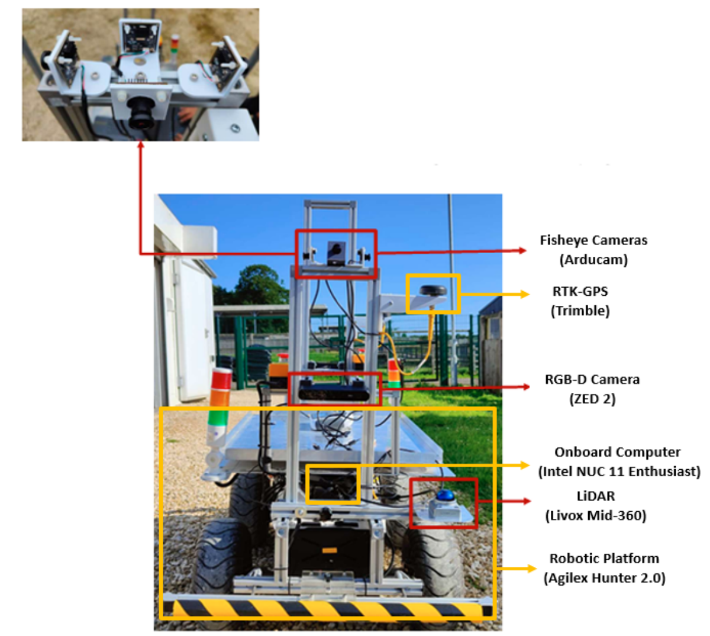
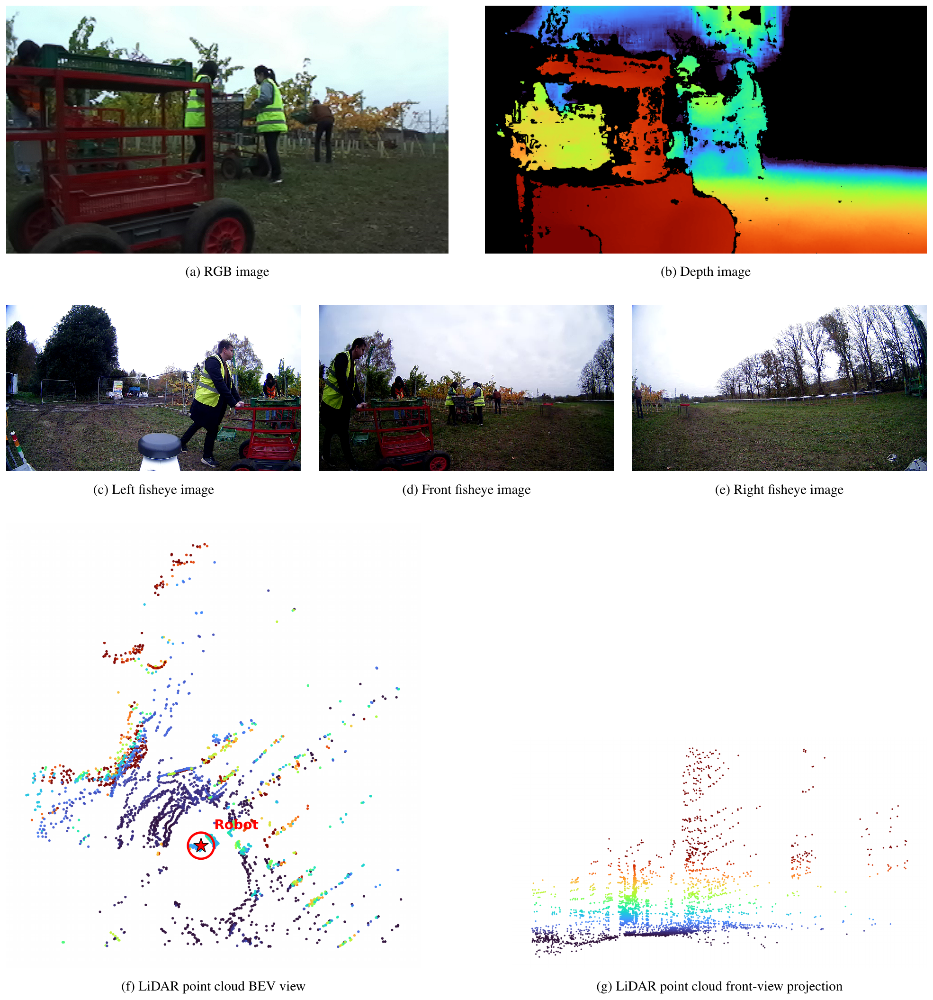
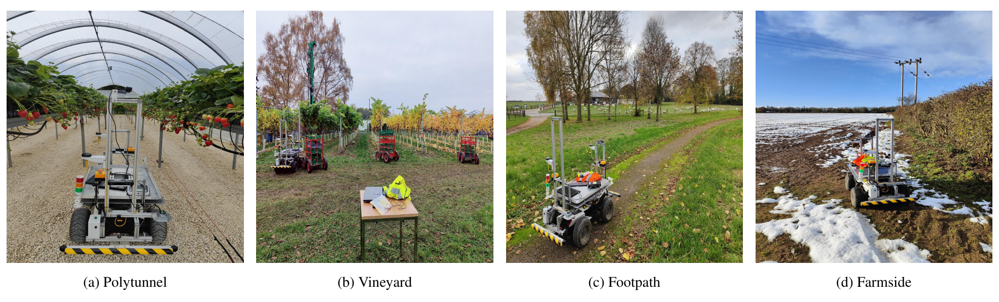
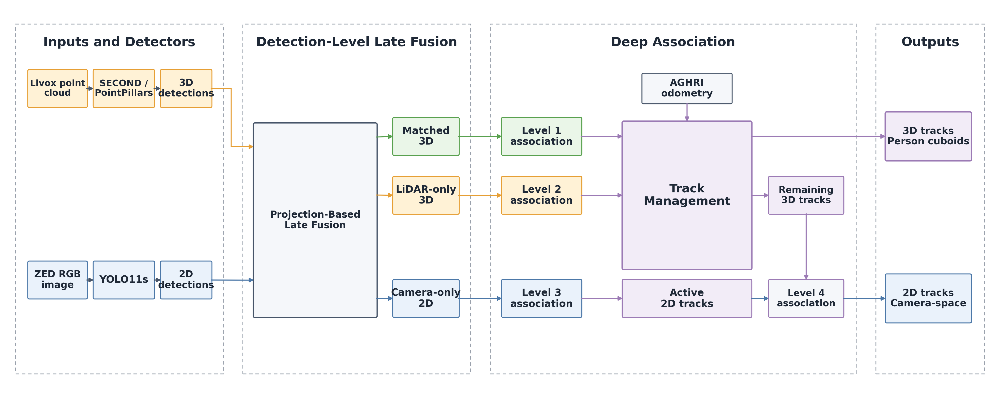
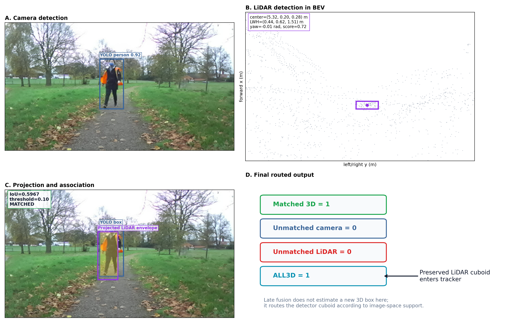

# Workshop background: AGHRI dataset and late camera-LiDAR fusion

This page introduces the AGHRI dataset and the late camera-LiDAR human detection fusion and multi-object tracking pipeline used in the demo. The [main README](../README.md) has the setup commands and activities.

## Section 1 — AGHRI Dataset Overview

### ▶ Watch the AGHRI Dataset Video

[Watch the AGHRI dataset video](https://www.youtube.com/watch?v=nL7mKnMcCzc)

**AGHRI** is a multimodal dataset developed for robot perception of humans in agricultural and off-road environments. It was designed for close-proximity human–robot interaction scenarios in which a compact mobile robot operates around farm workers in cluttered, dynamic, and frequently occluded environments.

AGHRI supports research on:

- 2D human detection
- 3D human detection
- 2D multi-object tracking
- 3D multi-object tracking
- person re-identification
- camera–LiDAR fusion

### Robotic Platform and Sensors

AGHRI was collected on an **Agilex Hunter 2.0** with a **ZED 2 RGB-D camera**, three **Arducam fisheye cameras**, and a **Livox Mid-360 LiDAR**.

The modalities capture different views of the same scene: RGB appearance, depth, wide-angle fisheye images, and a 3D point cloud.

### Collection Environments

The dataset was recorded at the University of Lincoln's Riseholme Campus in Lincoln, United Kingdom, between October and November 2024. It covers four environments:

- Strawberry polytunnel
- Vineyard
- Footpath
- Farmside

Recordings include sunny and overcast conditions, with snow present in some polytunnel, footpath, and farmside sessions.

### Activities

AGHRI contains single-person and multi-person sequences covering common movement and agricultural work activities.

**Common activities:**

- Walking
- Standing
- Talking
- Checking or looking at the robot

**Agricultural activities:**

- Pushing a trolley
- Carrying a tray
- Swapping trays
- Picking strawberries
- Picking grapes

The robot is recorded in both stationary and moving states.

### Annotations and Identities

AGHRI provides **2D and 3D human annotations** with participant-level identities that remain consistent across the annotated modalities and released sequences.

**Today's demo uses the ZED RGB camera and Livox LiDAR** from two recordings in different environments: `footpath` and `vine` (vineyard).

A dataset identity is ground truth; a number assigned by DeepFusionMOT during this demo is a separate tracker ID.

## Section 2 — Late Camera-LiDAR Human Detection Fusion and Multi-Object Tracking (DeepFusionMOT)

- **Goal:** detect multiple people and keep their identities over time using camera and LiDAR.
- **YOLO11s** finds people as 2D boxes in the ZED RGB image.
- **PointPillars** finds people as 3D cuboids in the LiDAR point cloud.
- **Late fusion** decides which camera and LiDAR detections describe the same person.
- The **AGHRI DeepFusionMOT adaptation** associates detections with existing tracks and assigns persistent IDs.
- **RViz2** shows the camera boxes, LiDAR proposals, matches, unmatched proposals, and tracks.

In **GPU mode**, both detectors run on each replayed sensor stream. In **CPU mode**, their saved predictions are replayed. Fusion and tracking run live in both modes.

The original DeepFusionMOT research uses a camera–LiDAR tracking framework; this workshop uses its AGHRI adaptation for people.

### Figure 1: AGHRI late-fusion and deep-association architecture

The wider AGHRI benchmark supports **SECOND or PointPillars** for LiDAR detection; this workshop selects **PointPillars**. The diagram follows detections through late fusion, four association levels, track management, and the **2D and 3D track outputs**.

### How one camera–LiDAR match is made

1. YOLO11s produces a 2D person box; PointPillars produces a 3D person cuboid.
2. Calibration transforms the LiDAR cuboid into the camera view. Its projected corners form a 2D image envelope.
3. The fusion node compares that envelope with camera boxes using image-space intersection over union (**IoU**) and assigns candidate pairs.
4. It sends results down three paths: **matched 3D**, **unmatched LiDAR 3D**, and **unmatched camera 2D**. A match preserves the detector's 3D cuboid.

### Figure 2: Same-frame camera–LiDAR association example

In this footpath frame, the projected LiDAR envelope overlaps the YOLO box with **IoU ≈ 0.597**. That exceeds the workshop's default **0.10** threshold, so it becomes a camera-supported 3D detection. The figure is one frame; tracking uses evidence across successive frames.

### Four levels of data association

The tracker predicts where existing tracks should be, then associates new evidence in this order:

| Level | New evidence and existing tracks | What it does |
| --- | --- | --- |
| **1** | Camera-matched 3D detections → existing 3D tracks | Updates 3D tracks with detections supported by both sensors. |
| **2** | LiDAR-only 3D detections → remaining 3D tracks | Can maintain a 3D track when no camera match was accepted. |
| **3** | Camera-only 2D detections → existing 2D tracks | Maintains a separate camera-space tracking branch. |
| **4** | Updated 2D tracks → remaining projected 3D tracks | Uses compatible 2D evidence to support a 3D track that Level 1 or 2 did not update. |

Kalman prediction and robot-motion compensation prepare the tracks for each new frame; track management then updates, starts, or retires tracks after association.

The node publishes **3D tracks** on `/deepfusionmot/tracked_3d` and **2D tracks** on `/deepfusionmot/tracked_2d`. The workshop's RViz2 layout displays the 3D tracks and their camera projections. A red unmatched LiDAR box can therefore still contribute to a magenta track.

## Sources

- [AGHRI dataset tools and dataset overview](https://github.com/LCAS/AGHRI-dataset-tools)
- [AGHRI dataset release](https://doi.org/10.24385/lincoln.32982638)
- [AGHRI late-fusion benchmark](https://github.com/LCAS/AGHRI-dataset-benchmark)
- [Original DeepFusionMOT implementation](https://github.com/wangxiyang2022/DeepFusionMOT)
- [DeepFusionMOT paper](https://arxiv.org/abs/2202.12100)

The dataset photographs and sensor montage are reproduced from the local AGHRI Dataset Tools workspace. Figures 1 and 2 are reproduced from the local AGHRI late-fusion benchmark workspace.
